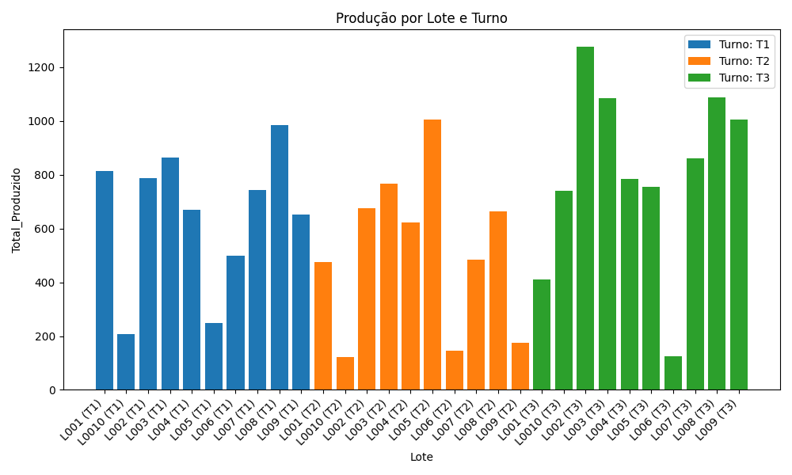

# Report-Python-SQL

Generates a production report from SQL Server: a query is run with Python, exported to Excel, and drawn as a bar chart of total produced by batch and shift.

All data is **simulated**. There is no company or client data in this repository.



## How it works

1. `kpi_query.sql` sums the units produced and averages the efficiency per batch (`Lote`) and shift (`Turno`).
2. `report_generator.py` runs the query with pandas, writes `Outputs/report.xlsx` and `Outputs/chart.png`.
3. `connect_db.py` builds the SQL Server connection from environment variables, so no server name or password is stored in the code.

## Setup

Requirements: Python 3.10+, the Microsoft ODBC Driver for SQL Server, and a SQL Server you can reach.

```bash
pip install -r requirements.txt
cp .env.example .env        # then edit DB_SERVER and DB_NAME
```

Create the sample table (run `sql/01_create_sample_data.sql` in your database), then:

```bash
python report_generator.py
```

The report and the chart appear in the `Outputs/` folder.

## Stack

Python · pandas · matplotlib · SQLAlchemy · SQL Server (T-SQL)
